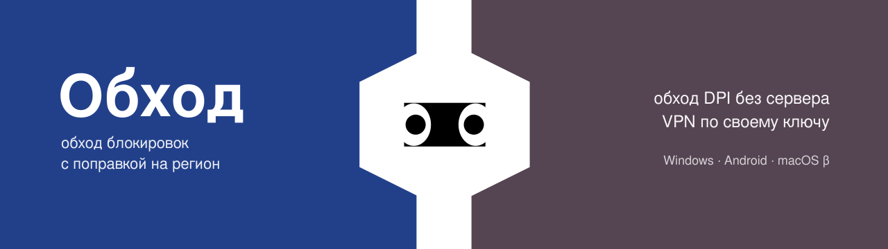
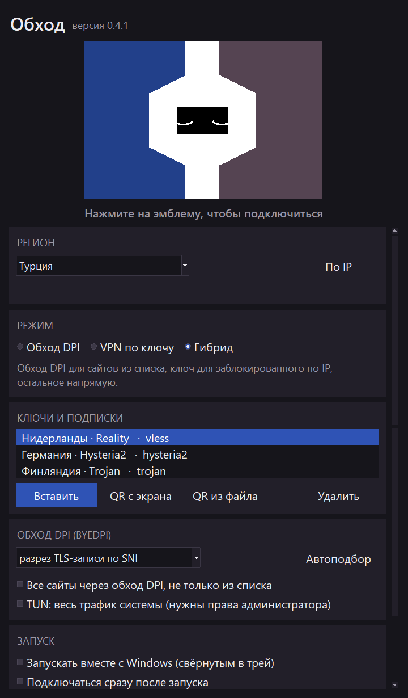
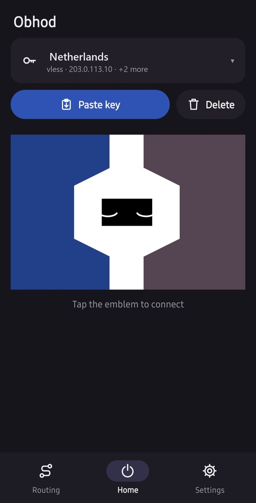
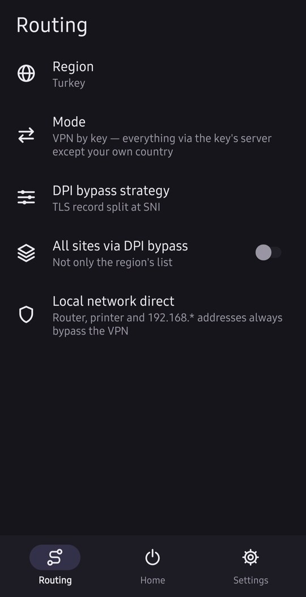
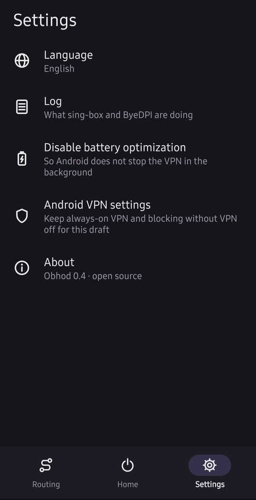

  

  
  
  
  
  

# Обход

Open-source клиент для обхода блокировок с поправкой на регионы. Совмещает два подхода:

- **обход DPI без сервера**, как Zapret: локальный [ByeDPI](https://github.com/hufrea/byedpi) меняет пакеты так, чтобы фильтр провайдера их не узнал;
- **VPN по своему ключу**, как Hiddify: [sing-box](https://github.com/SagerNet/sing-box), ключи `vless://` (в том числе Reality), `vmess://`, `trojan://`, `ss://`, `hy2://`, `tuic://` и подписки.

Режим и стратегия подбираются под регион: Россия, Турция, Иран, Китай или другая страна. Интерфейс — на русском, английском, турецком, персидском и китайском. В Windows-версии есть встроенная игра «Блоки» в цветах эмблемы — скоротать время, пока подбирается стратегия.

> **Статус: черновик.** Проверено вживую на Windows 11 и Android 15 в Турции. В других странах стратегии могут потребовать подстройки — для этого есть автоподбор.

## Как выглядит

<table>
  <tr>
    <th>Windows</th>
    <th colspan="3">Android</th>
  </tr>
  <tr>
    <td valign="top"></td>
    <td valign="top"></td>
    <td valign="top"></td>
    <td valign="top"></td>
  </tr>
</table>

Нажмите на эмблему: глаза открыты — подключено. Ключи на скриншотах демонстрационные.

## Скачать

Последняя версия — на странице **[Releases](../../releases/latest)**:

| файл | для чего |
| --- | --- |
| `Obhod-<версия>-windows.exe` | Windows 10/11, 64-бит |
| `obhod-<версия>-android-arm64.apk` | Android 10+, обычные телефоны |
| `obhod-<версия>-android-x86_64.apk` | эмуляторы и редкие x86-устройства |
| macOS (бета) | готового файла пока нет — установка из исходников за несколько минут: [инструкция для Mac](https://github.com/vlasyazoy-oss/obhod/blob/feature/macos/obhod/MACOS.md) |
| `SHA256SUMS.txt` | контрольные суммы файлов |

### Windows

1. Запустите `Obhod.exe`. Он не подписан, поэтому SmartScreen предупредит: «Подробнее» → «Выполнить в любом случае».
2. При первом запуске «Обход» предложит скачать движки (sing-box и ByeDPI, около 35 МБ) с их официальных страниц GitHub в `%LOCALAPPDATA%\Obhod`.
3. Нажмите на эмблему. Глаза открыты — подключено.

По умолчанию работает через системный прокси, без прав администратора. Галочка **TUN** перехватывает весь трафик системы (игры, клиенты, которые не слушают прокси, голос) и попросит перезапуск от администратора.

### Android

1. Установите APK: Android попросит разрешить установку из этого источника, Play Защита может предупредить — «Всё равно установить».
2. При первом подключении Android спросит разрешение на VPN.

Всё нужное уже внутри APK, root не нужен.

## Режимы

| режим | что идёт куда |
| --- | --- |
| **Обход DPI** | сайты из списка региона — через ByeDPI, остальное напрямую. Сервер не нужен |
| **VPN по ключу** | всё через ваш сервер, кроме сайтов своей страны и локальной сети |
| **Гибрид** | обход DPI для списка, ключ — для того, что заблокировано по IP |

В Китае локальный обход DPI не помогает (блокируются сами IP-адреса), поэтому там нужен ключ. В Иране обход DPI помогает частично.

## Из исходников

Windows-версия (Python 3.8+) и Android-версия (Kotlin) лежат в [`obhod/`](obhod/), инструкции по сборке и тестам — в [`obhod/README.md`](obhod/README.md). Разбор Zapret 2 и Hiddify, с которых начинался проект, — в [`replica/`](replica/).

## Сторонние компоненты

| компонент | лицензия | где |
| --- | --- | --- |
| [sing-box](https://github.com/SagerNet/sing-box) | GPL-3.0 | маршрутизация, VPN по ключу, TUN |
| [ByeDPI](https://github.com/hufrea/byedpi) | MIT | обход DPI |
| [hev-socks5-tunnel](https://github.com/heiher/hev-socks5-tunnel) | MIT | туннель на Android |
| [pystray](https://github.com/moses-palmer/pystray), [Pillow](https://python-pillow.org), [zxing-cpp](https://github.com/zxing-cpp/zxing-cpp) | LGPL-3.0, MIT-CMU, Apache-2.0 | трей и QR в Windows-версии |

Windows-версия скачивает sing-box и ByeDPI с их официальных релизов, Android-версия содержит их внутри APK.

## Лицензия

[GPL-3.0](LICENSE).

Использование средств обхода блокировок в некоторых странах ограничено законом. Вы сами отвечаете за то, как и где используете программу.
